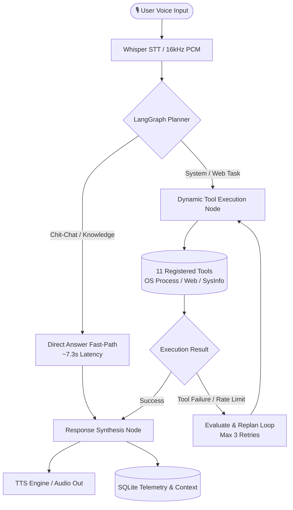

# KIRA — Local-First Autonomous Agentic Voice Assistant

[](https://www.python.org/)
[](https://github.com/langchain-ai/langgraph)
[-black.svg?logo=ollama&logoColor=white)](https://ollama.com/)
[](https://github.com/SYSTRAN/faster-whisper)
[](https://reactnative.dev/)
[](https://www.sqlite.org/)
[](LICENSE)

**KIRA** is a privacy-first, fully local agentic voice assistant engineered with **LangGraph**, **Ollama (Qwen 2.5 3B)**, and **Whisper**. It combines local speech recognition, stateful agentic task planning, cyclic self-healing error recovery, Windows desktop OS automation, and live web intelligence into a unified voice-driven system.

---

## ⚡ Key Highlights & Architecture



### Core Features

* **Stateful Agent Planning (LangGraph):** Decomposes complex, multi-step natural language instructions into actionable execution graphs. Includes a conversational fast-path that bypasses tool invocation loops for chit-chat.
* **Autonomous Error Recovery (Self-Healing):** Employs a cyclical `evaluate_and_replan_node` with up to 3 automatic retries when tools encounter exceptions, missing parameters, or OS lockouts.
* **100% Local & Private:** Runs entirely on-device with zero external cloud API dependencies or recurring costs using **Qwen 2.5 (3B)** via Ollama.
* **Resilient Tooling Pipeline:** Integrates 11 custom tools covering desktop process automation, browser control, web scraping, and live DuckDuckGo web search with automatic failover to the Wikipedia Search API on rate-limiting.
* **Local Telemetry & Memory:** Tracks multi-turn session history, tool arguments, latency stats, and execution logs in an embedded SQLite database.
* **Cross-Platform Client (Expo / React Native):** Mobile and desktop interface scaffold with real-time audio recording, chat logs, and telemetry controls.

---

## 📊 Empirical Benchmarks & Performance Metrics

KIRA was evaluated on a dedicated **40-scenario benchmark suite** ([tests/benchmark_cases.json](tests/benchmark_cases.json)) spanning 6 operational domains:

| Metric Category | Measured Result | Evaluation Context |
| :--- | :---: | :--- |
| **Overall Benchmark Pass Rate** | **92.5%** (37 / 40) | Full test suite across 6 tool categories |
| **Standard User Intent-to-Action Rate** | **97.0%** (32 / 33) | Real-world tasks (excluding deliberate adversarial inputs) |
| **Multi-Step Workflow Accuracy** | **100.0%** (5 / 5) | Multi-tool chained goals (search + browser + summarize) |
| **OS App Management Accuracy** | **100.0%** (7 / 7) | Launching, closing, and listing Windows processes |
| **Conversational Fast-Path Latency** | **7.3s – 8.8s** | 2.5x speedup bypassing tool planner loops |
| **Multi-Step Agentic Latency** | **12.5s** (Avg) | End-to-end task decomposition, network fetch, and synthesis |
| **Python Orchestration Memory** | **92.7 MB RAM** | Peak memory consumption of Python/LangGraph engine |
| **API Fallback Recovery Rate** | **100.0%** | Resilient failover from DuckDuckGo rate limits to Wikipedia API |

### Category Breakdown

```text
Category                   | Passed   | Pass Rate  | Avg Latency
-----------------------------------------------------------------
Conversational             | 6 / 6    | 100.0 %    | 8.84s
OS App Management          | 7 / 7    | 100.0 %    | 9.44s
Web Search & Navigation    | 7 / 7    | 100.0 %    | 12.97s
Web Scraping               | 3 / 3    | 100.0 %    | 19.20s
Multi-Step Complex         | 5 / 5    | 100.0 %    | 19.23s
System Utilities           | 4 / 5    | 80.0  %    | 12.47s
Tricky / Failure Handling  | 5 / 7    | 71.4  %    | 10.79s
-----------------------------------------------------------------
TOTAL                      | 37 / 40  | 92.5  %    | 12.54s
```

---

## 🛠️ Tool Ecosystem

KIRA includes 11 registered tools registered under a structured schema:

1. **`launch_application`**: Launches desktop applications (Notepad, Calculator, Edge, VS Code, File Explorer).
2. **`close_application`**: Gracefully terminates running processes matching target application names.
3. **`list_running_applications`**: Inspects and filters active operating system processes.
4. **`search_web`**: Queries the live internet via DuckDuckGo with automated Wikipedia API fallback.
5. **`open_url`**: Opens URLs in the user's default desktop browser.
6. **`open_url_in_edge`**: Directly controls and launches URLs in Microsoft Edge.
7. **`search_and_open_youtube`**: Searches and navigates directly to YouTube queries in one step.
8. **`fetch_page_content`**: Scrapes and parses readable text from webpages using BeautifulSoup4.
9. **`get_system_info`**: Retrieves real-time CPU utilization, RAM usage, and available disk space.
10. **`get_datetime`**: Provides formatted date, time, and day-of-week context.
11. **`take_screenshot`**: Captures and saves full-screen screenshots to local storage.

---

## 📁 Repository Structure

```text
voice_assistant/
├── app/                        # Python Agentic Backend
│   ├── agent/                  # LangGraph state machine & orchestration
│   │   ├── graph.py            # StateGraph definitions & nodes
│   │   ├── planner.py          # LLM goal decomposition & replanning
│   │   ├── prompts.py          # System prompts & schema guidelines
│   │   └── state.py            # TypedDict AgentState definitions
│   ├── core/                   # Global configuration & safety checks
│   │   ├── config.py           # Pydantic environment configuration
│   │   ├── logging.py          # Structured log formatting
│   │   └── safety.py           # Dangerous command guardrails
│   ├── memory/                 # SQLite persistence layer
│   │   ├── database.py         # SQLite connection manager & migrations
│   │   └── repository.py       # Session, conversation, & log CRUD
│   ├── tools/                  # Registered tool definitions
│   │   ├── applications.py     # OS process management
│   │   ├── filesystem.py       # Sandboxed file operations
│   │   ├── system.py           # CPU, RAM, and screenshot utilities
│   │   ├── utilities.py        # Date/time and clipboard helpers
│   │   └── web.py              # Search, scraping, and YouTube automation
│   ├── voice/                  # Speech I/O modules
│   │   ├── speech_to_text.py   # Whisper STT & 16kHz audio capture
│   │   └── text_to_speech.py   # pyttsx3 / Edge-TTS audio output
│   ├── api.py                  # FastAPI REST endpoints
│   └── main.py                 # Interactive terminal assistant entrypoint
├── src/                        # React Native / Expo Frontend
│   ├── components/             # Reusable UI components
│   ├── screens/                # Mobile / Desktop interface screens
│   └── utils/                  # Client-side audio & API utilities
├── tests/                      # Testing & Evaluation Suite
│   ├── benchmark_cases.json    # Standardized 40-case benchmark dataset
│   ├── benchmark_results.csv   # Raw benchmark execution metrics
│   ├── test_agent_graph.py     # LangGraph integration unit tests
│   ├── test_memory.py          # SQLite database unit tests
│   └── test_tools.py           # Custom tool execution tests
├── benchmark_harness.py        # Automated 40-case benchmark execution harness
├── extract_metrics.py          # Local SQLite telemetry metric extractor
├── requirements.txt            # Python dependencies
├── package.json                # Frontend Expo dependencies
├── .env.example                # Environment variable configuration template
└── README.md
```

---

## 🚀 Getting Started

### Prerequisites

* **Python 3.10+** (tested on 3.10, 3.11, 3.12, 3.14)
* **Node.js 18+** & `npm` (for the optional Expo client)
* **Ollama**: Download and install from [ollama.com](https://ollama.com/)

### 1. Setup Local LLM

Pull the default local model:
```bash
ollama run qwen2.5:3b
```

### 2. Backend Setup

```bash
# Clone repository
git clone https://github.com/Preethis-23/voice_assistant.git
cd voice_assistant

# Create and activate virtual environment
python -m venv .venv
# Windows:
.venv\Scripts\activate
# Linux/macOS:
source .venv/bin/activate

# Install dependencies
pip install -r requirements.txt

# Configure environment variables
cp .env.example .env
```

### 3. Run KIRA

**Interactive Terminal Voice Assistant:**
```bash
python -m app.main
```

**FastAPI Server (for frontend connectivity):**
```bash
python -m app.api
```

**Run Automated 40-Scenario Benchmark:**
```bash
python benchmark_harness.py
```

**Extract SQLite Telemetry Metrics:**
```bash
python extract_metrics.py
```

### 4. Optional Frontend (Expo / React Native)

```bash
# Install frontend packages
npm install

# Start Expo development server
npm start
```

---

## 🛡️ Safety & Guardrails

* **Destructive Action Confirmation:** Safety middleware flags potentially destructive system modifications (`format`, file deletions) and prompts for explicit user approval.
* **Loop Prevention:** LangGraph cyclical nodes are bound to a strict recursion limit (`max_retries = 3`) preventing infinite replan loops.
* **Isolated Tool Executions:** All tools return structured `ToolResult` objects containing explicit error strings and recovery flags rather than crashing the primary daemon.

---

## 📄 License

This project is licensed under the MIT License — see the [LICENSE](LICENSE) file for details.
